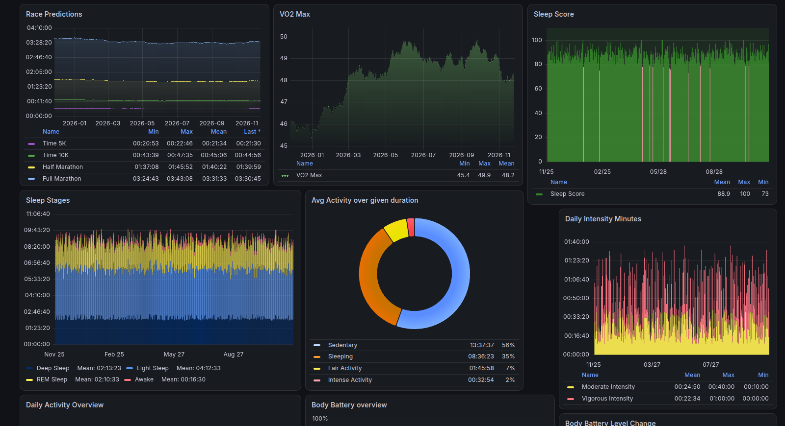
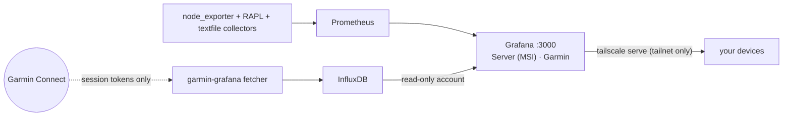

# msi-homelab

A gaming laptop turned into a headless home server: **how it was set up**, **how
it is monitored** (Prometheus + Grafana, everything on loopback, reachable only
through Tailscale), and an optional **Garmin module** that puts your watch data
in the same Grafana — without the data ever leaving the machine.


| Server health (real machine, overview) | Garmin, one year (invented demo data) |
|---|---|
|  |  |

The server was set up to host Sound Archive, a personal audio project with a
map, which is paused until the storage grows. This repository documents the
server, the panel and the Garmin module, which work on their own.

## Try it in three commands

Needs Docker with Compose v2 and free ports 13300, 18086 and 18088.

```sh
git clone <this repository's URL> msi-homelab && cd msi-homelab
scripts/init-env.sh                                  # .env with random passwords, never printed
make demo COMPOSE_PROJECT_NAME=homelab-dev           # then open http://127.0.0.1:13300
```

A year of **invented** Garmin-like data and both dashboards, read-only, in RAM.
`make demo-down COMPOSE_PROJECT_NAME=homelab-dev` removes it.

## How it fits together



Everything listens on `127.0.0.1`; images, upstream code, packages and CI
actions are pinned; the Garmin password is never stored and the fetcher stops
instead of retrying a login. Why: [docs/decisions/](docs/decisions/).

## Repository map

| Path | What |
|---|---|
| [stacks/monitoring/](stacks/monitoring/) | node_exporter, RAPL exporter, textfile collector, Prometheus, Grafana; optional `pvpc` and `apphealth` profiles |
| [stacks/garmin/](stacks/garmin/) | InfluxDB, fetcher built from a pinned commit, one-shot login, vendored dashboard, demo, offline tests |
| [docs/runbook/](docs/runbook/) | installing and configuring the server, step by step |
| [docs/](docs/) | [ARCHITECTURE](docs/ARCHITECTURE.md) · [SECURITY](docs/SECURITY.md) · [GARMIN](docs/GARMIN.md) · [lessons](docs/lessons.md) · [ROADMAP_LOCAL_LLM](docs/ROADMAP_LOCAL_LLM.md) · [PUBLISH_CHECKLIST](docs/PUBLISH_CHECKLIST.md) |
| [host/](host/) · [scripts/](scripts/) · `Makefile` | host templates · env, audit, backup, dashboard and screenshot scripts · `make help` |

## Terms of service and limits

The Garmin module uses **unofficial** access
([garmin-grafana](https://github.com/arpanghosh8453/garmin-grafana),
[python-garminconnect](https://github.com/cyberjunky/python-garminconnect)); it
**may breach Garmin's terms of service** and can be blocked at any time. The
official data export is the safe alternative ([GARMIN.md](docs/GARMIN.md)). Not
medical advice.

**Not verified:** anything needing a real Garmin account (login, token renewal,
real data); this repository's monitoring stack started for real (validated with
`docker compose config`; the deployment it comes from runs); the battery limit
after a cold boot. No alerts or off-site backups yet.

## History and credits

History starts here (November 2026); earlier work was private and is summarised
in the runbook and decisions. Garmin dashboard and fetcher by Arpan Ghosh
(garmin-grafana, BSD-3-Clause). Battery driver:
[BeardOverflow/msi-ec](https://github.com/BeardOverflow/msi-ec). Own code: MIT.
