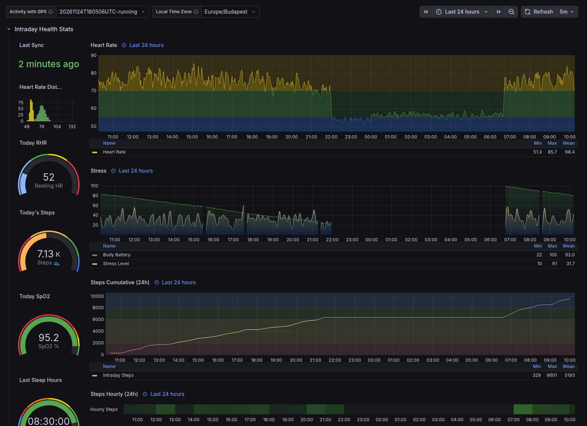
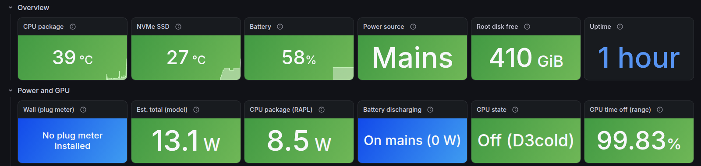
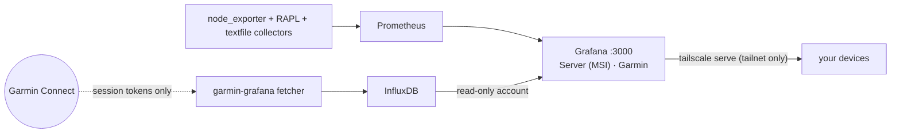

# msi-homelab

A gaming laptop turned into a headless home server: **how it was set up**, **how
it is monitored** (Prometheus + Grafana, everything on loopback, reachable only
through Tailscale), and an optional **Garmin module** that puts your watch data
in the same Grafana — without the data ever leaving the machine.



| Server health (real machine, overview row) | Garmin, one year (invented demo data) |
|---|---|
|  |  |

The server was set up to host Sound Archive, a personal audio project with a
map, which is paused until the storage grows. This repository documents the
server, the panel and the Garmin module, which work on their own.

## Try it in three commands

Needs Docker with Compose v2 and free ports 13300, 18086 and 18088.

```sh
git clone <this repository's URL> msi-homelab && cd msi-homelab
scripts/init-env.sh                                  # .env with random passwords, never printed
make demo COMPOSE_PROJECT_NAME=homelab-dev           # then open http://127.0.0.1:13300
```

A year of **invented** Garmin-like data and both dashboards, read-only, all in
RAM; `make demo-down COMPOSE_PROJECT_NAME=homelab-dev` removes it. The server
dashboard fills in if a Prometheus answers on `127.0.0.1:9090`.

## How it fits together



Every service listens on `127.0.0.1`; nothing is published with Docker ports
(they would bypass the firewall). Details: [ARCHITECTURE.md](docs/ARCHITECTURE.md).

## Repository map

| Path | What |
|---|---|
| [stacks/monitoring/](stacks/monitoring/) | Compose stack: node_exporter, RAPL exporter, textfile collector, Prometheus, Grafana; optional profiles `pvpc` (electricity price) and `apphealth` (HTTP probe) |
| [stacks/garmin/](stacks/garmin/) | optional module: InfluxDB, fetcher built from a pinned upstream commit, one-shot login, vendored dashboard, demo seeder, offline tests |
| [docs/runbook/](docs/runbook/) | installing and configuring the server, step by step, with checks and undo |
| [docs/decisions/](docs/decisions/) | one page per decision: why, alternatives, status |
| [docs/lessons.md](docs/lessons.md) | real problems met and how they were solved |
| [docs/GARMIN.md](docs/GARMIN.md) · [SECURITY.md](docs/SECURITY.md) · [ROADMAP_LOCAL_LLM.md](docs/ROADMAP_LOCAL_LLM.md) · [PUBLISH_CHECKLIST.md](docs/PUBLISH_CHECKLIST.md) | module guide, threat model, design for a local model, pre-publication checks |
| [host/](host/) | sanitized templates of the files changed on the host |
| [scripts/](scripts/) | `init-env.sh`, `audit-public.sh`, `backup-volumes.sh`, `vendor-dashboard.py`, screenshots |
| `Makefile` | `make help`; refuses to run without an explicit, safe Compose project name |

## Design choices, briefly

- **Loopback only**, one Grafana with two folders, private access through
  `tailscale serve`, never `funnel` ([0010](docs/decisions/0010-host-network-loopback.md), [0016](docs/decisions/0016-panel-only-inside-tailscale.md), [0026](docs/decisions/0026-single-grafana-two-folders.md)).
- **Pinned everything**: images by tag and digest, upstream code by commit,
  Python packages by hash, CI actions by SHA ([THIRD_PARTY_NOTICES.md](THIRD_PARTY_NOTICES.md)).
- **Garmin without a stored password**: one manual login, tokens only, and a
  fetcher that stops instead of retrying ([0028](docs/decisions/0028-garmin-login-tokens-only.md)).
- **Adopts the running panel's data**: same volume keys, same project name
  ([0024](docs/decisions/0024-adopt-existing-volumes.md)).

## Security and terms of service

Threat model and known limits: [SECURITY.md](docs/SECURITY.md). The Garmin
module uses **unofficial** access through
[garmin-grafana](https://github.com/arpanghosh8453/garmin-grafana) and
[python-garminconnect](https://github.com/cyberjunky/python-garminconnect);
it **may breach Garmin's terms of service** and can stop working or get blocked
at any time. Garmin's official data export is the safe alternative
([GARMIN.md](docs/GARMIN.md)). Nothing here is medical advice.

## Limits and what is not verified

- The Garmin login, token renewal and real data: **not verified** (no real
  account was used while building this); tested only offline and with invented data.
- This repository's monitoring stack has been validated (`docker compose
  config`) but **not started for real** here: the original deployment it was
  copied from runs and is verified.
- Not verified: the battery limit after a cold boot; Grafana's memory with the
  Garmin module on the real server; the exact `tailscale serve` syntax.
- Two state-timeline panels of the server dashboard can render empty in
  headless screenshots (lessons, P-49).
- No alerts, no off-site backups yet ([runbook 15](docs/runbook/15-backups.md)).

## Roadmap

Backups with restore tests; reboot and cold-boot tests; a local language model
over the Garmin data, read-only and offline — design in
[ROADMAP_LOCAL_LLM.md](docs/ROADMAP_LOCAL_LLM.md).

## History and credits

This repository's history starts here (November 2026); the work before it
lived in private repositories and is summarised in the runbook and decisions.
Garmin dashboard and fetcher by Arpan Ghosh ([garmin-grafana](https://github.com/arpanghosh8453/garmin-grafana),
BSD-3-Clause) — consider supporting the project. Battery driver:
[BeardOverflow/msi-ec](https://github.com/BeardOverflow/msi-ec). Own code: MIT ([LICENSE](LICENSE)).
