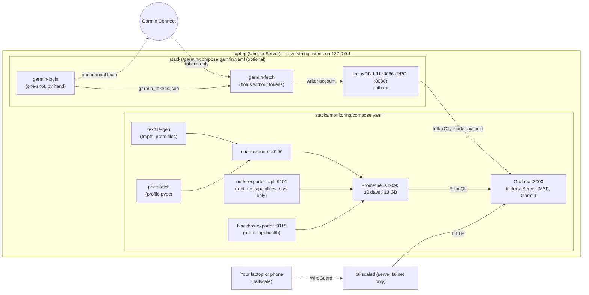

# Architecture

One laptop running Ubuntu Server; two Docker Compose files; one Grafana.

## Data flows

| From → to | What | How often |
|---|---|---|
| kernel (`/proc`, `/sys`) → node-exporter → Prometheus | host metrics | every 15 s |
| `/sys/class/powercap` → node-exporter-rapl → Prometheus | CPU energy counters | every 15 s |
| textfile-gen → tmpfs → node-exporter | GPU power state, fans, charge limits, throttling, updates | every 15 s |
| public price API → price-fetch → tmpfs (optional) | electricity price | every 15 min |
| blackbox-exporter → a local web app (optional) | GET health URLs | every 30 s |
| Garmin Connect → garmin-fetch → InfluxDB | health data, activities | every 5 min, only with valid tokens |
| Prometheus, InfluxDB → Grafana | queries when a chart is drawn | on demand |

## Ports (all bound to 127.0.0.1)

| Port | Service | Login |
|---|---|---|
| 3000 | Grafana (also served inside the tailnet) | yes |
| 9090 | Prometheus | **no** — loopback only |
| 9100, 9101 | node_exporter, RAPL exporter | no — loopback only |
| 9115 | blackbox_exporter (optional) | no — loopback only |
| 8086, 8088 | InfluxDB HTTP, backup RPC (Garmin module) | yes (HTTP) |
| 13300, 18086, 18088 | demo Grafana and InfluxDB (`make demo`, throwaway) | demo: read-only anonymous |

## Volumes

| Volume | Content | Persistent |
|---|---|---|
| `<project>_prometheus-data` | metric history | yes |
| `<project>_grafana-data` | Grafana's database | yes |
| `<project>_textfile-gen` | `.prom` files | tmpfs, 1 MB, rebuilt at start |
| `<project>_influxdb-data` | Garmin time series | yes |
| `<project>_garmin-tokens` | session tokens, hold marker | yes |

The volume **keys** match the original deployment, so the same project name
adopts its history ([decision 0024](decisions/0024-adopt-existing-volumes.md)).

## Why it is built this way

- Host networking and loopback binding, because Docker-published ports bypass
  the firewall ([0010](decisions/0010-host-network-loopback.md)).
- Configuration as files: datasources and dashboards are provisioned from git;
  the UI cannot save over them.
- The Garmin module is a second compose file that **adds** to the first; the
  Grafana provisioning files are mounted one by one so it can add its own
  ([0026](decisions/0026-single-grafana-two-folders.md)).
- The upstream Garmin dashboard is vendored unchanged and transformed by a
  deterministic script that CI re-runs ([0029](decisions/0029-heatmap-without-plugin.md)).

## Resource use

Measured on the original deployment (2026-11-02/03, idle): Grafana ~210–250 MiB,
Prometheus ~40–60 MiB, node_exporter ~10 MiB; Prometheus grows ~15.5 MB/day.
Measured in the demo (2026-11-26): InfluxDB ~240–280 MiB with a year of invented
data (28 MB on disk); Grafana ~500 MiB with its database in RAM. The Garmin
module on the real panel: **not measured**.
